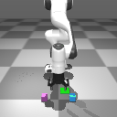
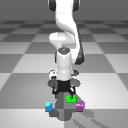

# Language-Conditioned Robotic Grasping in MuJoCo

A reproducible simulation baseline for language-directed two-object robotic grasping with a Franka Panda and Robotiq 2F-85 gripper.

## Pipeline

`language command -> visual object detection -> target routing -> Cartesian alignment -> descend -> close -> lift`

Supported commands in the current demo/evaluation are `left`, `right`, `purple`, and `blue`.

## Demo

| Spatial command | Color command after position swap |
| --- | --- |
| `left` selects and grasps the purple object | `blue` selects and grasps the blue object |
|  |  |

Both animations are recorded directly from MuJoCo runs using the same perception, routing, and staged grasp-control logic as the evaluation pipeline.

## Results

| Evaluation | Detection | Routing | Grasp |
| --- | ---: | ---: | ---: |
| Fixed-position evaluation | 36/36 | 36/36 | 36/36 |
| Random unseen-Y evaluation | 50/50 | 50/50 | 50/50 |

The random evaluation samples both objects over Y in `[-0.16, 0.16] m` with at least `0.08 m` separation. These results describe the **hybrid perception-routing-expert-control pipeline** in simulation; they are not evidence that the original VLA checkpoint independently achieved end-to-end language understanding or 100% grasp success.

## Why this baseline exists

During VLA diagnosis, prompt changes such as left/right and purple/blue did not produce sufficiently distinct target-directed actions. The project therefore separates the problem into testable components: visual detection, command routing, and staged grasp control. This gives a reproducible baseline for later comparison with learned VLA policies.

## Repository layout

- `envs/` - MuJoCo/Gymnasium environment and robot assets.
- `scripts/demo_language_grasp.py` - single-command demo entry point.
- `scripts/record_language_grasp.py` - records a real MuJoCo grasp run as a GIF.
- `scripts/evaluate_fixed_positions.py` - 36-trial controlled evaluation.
- `scripts/evaluate_random_positions.py` - 50-trial unseen-Y evaluation.
- `results/` - CSV results from the reported evaluations.
- `experiments/` - reserved for compact ablations/diagnostics.
- `media/` - add demo GIFs or figures here.

## Setup

The environment code depends on `gym_hil`/LeRobot components in addition to the Python packages listed in `requirements.txt`. Install the compatible LeRobot/gym-hil environment used by your setup, then install the remaining dependencies.

From the repository root, run:

```bash
export PYTHONPATH=$PWD:$PYTHONPATH
export MUJOCO_GL=egl
python -u scripts/demo_language_grasp.py --prompt left
python -u scripts/demo_language_grasp.py --prompt blue --layout swapped
python -u scripts/evaluate_fixed_positions.py
python -u scripts/evaluate_random_positions.py
```

On systems with a display, `MUJOCO_GL=egl` may be changed according to the local MuJoCo rendering setup.

## Evaluation criterion

A trial is counted as a successful grasp when the selected object is lifted by more than `0.03 m` from its initial height. The CSV files also record detection, routing, selected target, lift distance, and failure stage.

## Current limitations

The public baseline currently randomizes object position along Y while keeping X fixed at `0.50 m`. Grasp motion uses simulator state for staged Cartesian control after target selection. Future work should randomize both X and Y, replace simulator-state targeting with visual closed-loop localization, and compare the hybrid baseline against retrained language-conditioned VLA policies.

## Third-party assets

The Franka Panda and Robotiq 2F-85 model assets are derived from Google DeepMind MuJoCo Menagerie. Panda is distributed under Apache-2.0 and Robotiq 2F-85 under BSD-2-Clause. Exact upstream license texts are retained beside the corresponding assets. See THIRD_PARTY_NOTICES.md.

